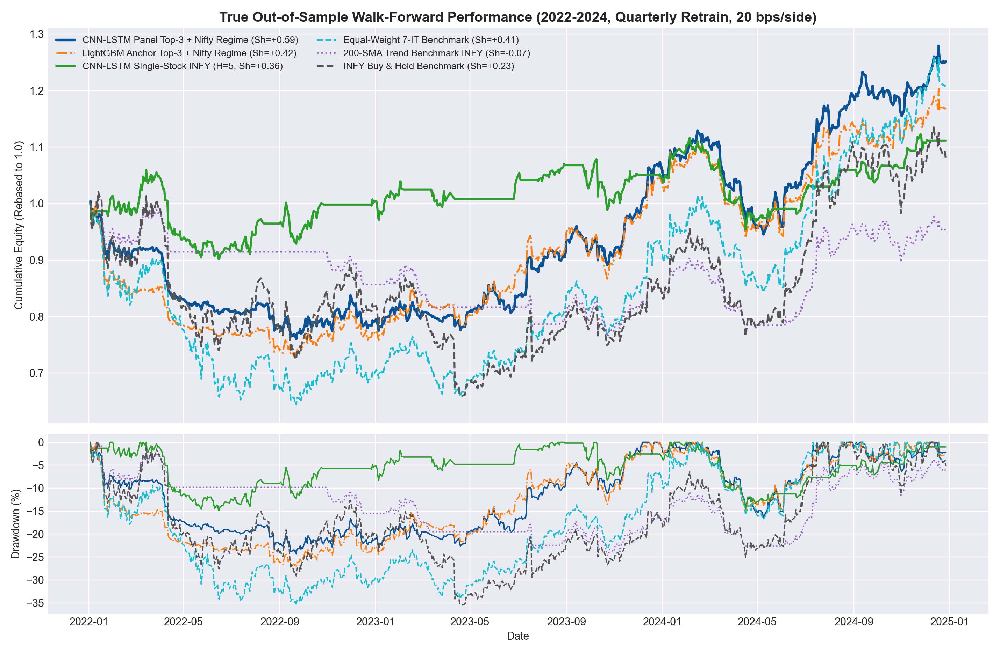
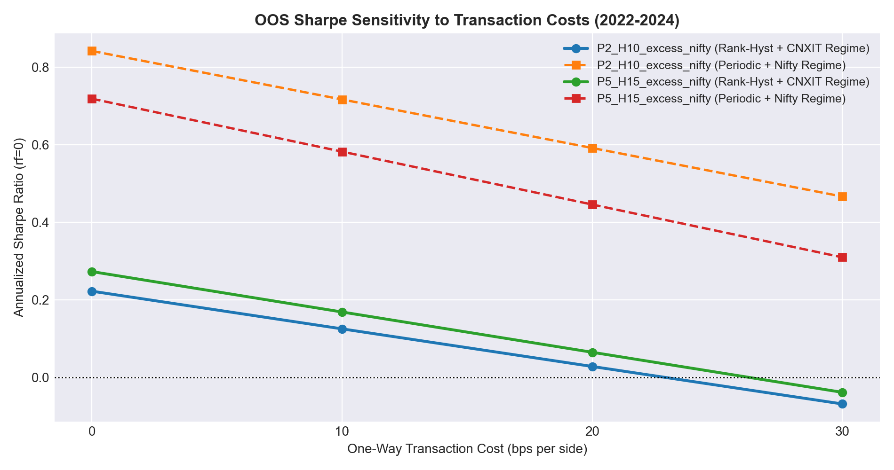
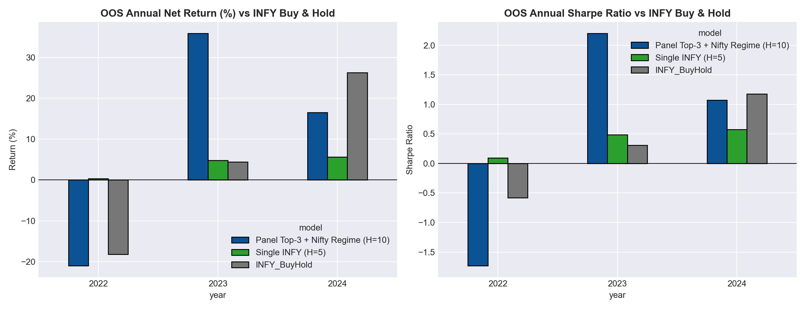
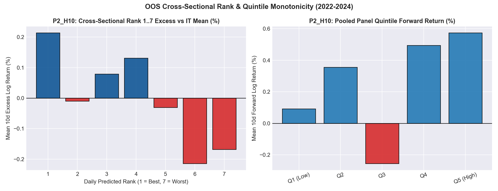

# CNN-LSTM Quantitative Trading Strategy for Infosys (`INFY.NS`) & NSE IT

A leakage-free, walk-forward **CNN-LSTM** (`Conv1D + LSTM`) equity strategy for Indian IT equities (`INFY.NS` and a 7-stock NSE IT sector panel), engineered with strict timezone causality, scale-invariant cross-market features, purged cross-validation, realistic NSE cash-delivery transaction costs (`20 bps/side`), institutional risk-free-adjusted Sharpe (`rf = 6%` T-bill proxy), and head-to-head out-of-sample (OOS) comparisons against `Ridge`, `LightGBM`, and passive benchmarks.

---

## 1. Engineering Overhaul & Root-Cause Fixes

The original exploratory notebooks (archived in `legacy/`) posted negative OOS Sharpe ratios (`-0.596` to `-0.718`) due to data, feature, target, and backtest bugs. This refactor preserves **CNN-LSTM** as the core model family while resolving every structural failure:

| Bug / Failure Mode in Legacy Notebooks | Root Cause | Fix Implemented Here |
|---|---|---|
| **Double split adjustment** | `yf.download(..., auto_adjust=False)` already returned split-adjusted OHLC (`₹132.47` in 2005), then a manual `0.5×` loop multiplied 4 bonus dates down to `₹8.28` and injected fake `+100%` jumps. | Switched to `auto_adjust=True` total-return prices (`src/data.py`), removed manual split loop, added `assert max_abs_log_ret < 0.40`. |
| **Backfilled market indices** | `^NSEI` starts `2007-09-17`, so `.bfill()` injected ~670 flat fake rows across `2005–2007`. | Sample starts cleanly on `2007-09-17` with native `^NSEI` and `^CNXIT` coverage (zero `.bfill()`). |
| **Non-stationary INR features** | `ATR_14`, `MACD`, `MACD_line`, `MACD_signal` in raw INR drifted `15×–200×`; `OBV.pct_change(5)` blew up near zero crossings. | Normalized to `Close` (`atr_14_pct`, `macd_pct`, `macd_line_pct`), replaced OBV ROC with `signed_vol_ratio`, added causal `252d` trailing z-scores. |
| **Cross-market timezone lookahead** | US equities (`^NDX`, `INFY` ADR) and FX (`INR=X`) close *after* NSE 15:30 IST. | Executed at `next_open` (`Open[t+1]`) with `merge_asof` causal alignment (`close` mode enforces strictly `date < t`). |
| **OOS leakage & quantile peeking** | CV Folds 4–6 overlapped `2022–2024`; `np.quantile(pred_oos, ...)` peeked across the full future OOS array. | Strict holdout wall (`< 2022-01-01` for all dev CV); purged & embargoed splits; strictly trailing causal quantiles (`shift(1).rolling(252)`). |
| **Stop-loss & cost-bleed bugs** | Stop-losses in `run_backtest_clean` were overwritten on the same bar; daily vol-targeting paid `20 bps` on tiny weight tweaks. | Fixed stop cooldown logic (`src/backtest.py`), added a `20%` NAV rebalance deadband, and aligned holding period (`min_hold_bars = 5`) to multi-day targets. |
| **Single-stock overfitting** | `39,425` parameters on `~3,800` noisy single-stock rows memorized noise (`AUC ≈ 0.49`). | Right-sized compact single-stock CNN-LSTM (`16/16` + `LayerNorm` + L2) AND built a **7-stock NSE IT Panel CNN-LSTM** (`32/32`, `~20k+` training sequences). |

---

## 2. Model Architecture & Methodology

### Core Architecture (`src/models.py`)
Both single-stock and sector-pooled models retain the hybrid **CNN-LSTM** structure:
```text
Input (seq_len=20, n_features)
  → Causal Conv1D (filters=16 or 32, kernel_size=3, ReLU, L2 reg)
  → LayerNormalization
  → MaxPooling1D (pool_size=2)
  → Dropout (0.30–0.35)
  → LSTM (units=16 or 32, L2 reg)
  → LayerNormalization
  → Dropout (0.30–0.35)
  → Dense(1)  [linear + Huber(1.0) for regression | sigmoid + BCE for classification]
```
- Predictions are averaged across **5 random seeds** (`[42..46]` in OOS; `3` seeds in dev CV) with `EarlyStopping` and `ReduceLROnPlateau` monitored on a strictly chronological trailing `12%` validation split.

### Features & Timezone Alignment (`src/features.py`)
- **Single-Stock Feature Set (`55` features)**:
  - **Price & Intraday (`15`)**: `ret_1d/3d/5d/10d/20d/63d`, `lag_1..5`, `gap_ret`, `intraday_ret`, `hl_range_pct`, `close_pos_in_range`
  - **Oscillators & Trend (`7`)**: normalized `rsi_14`, `macd_pct`, `macd_line_pct`, `dist_sma_20/50/200`, `dist_high_252`
  - **Volatility & Flow (`10`)**: `atr_14_pct`, `vol_10d/21d/63d`, `gk_vol_21d` (Garman-Klass), `vol_ratio_10_63`, `ret_skew_21`, `ret_kurt_21`, log-volume `vol_zscore_20`, `signed_vol_ratio`
  - **Indian Market & IT Index (`13`)**: `^NSEI` returns/vol/200-SMA distance, `^CNXIT` returns/200-SMA distance (`cnxit_dist_sma200`), relative spreads (`rel_nifty_5d/20d`, `rel_cnxit_5d/20d`), rolling 63d Nifty beta (`beta_nifty_63`)
  - **Global Tech & FX (`10`)**: `INR=X` (`1d/5d/20d`), `^NDX` (`1d/5d/20d`), `INFY` NYSE ADR (`1d/5d`), equal-weight `ACN+CTSH` (`1d/5d`). Verified via Yahoo hourly timestamps: `INR=X` daily bars close around `00:00 UTC` (`05:30 IST`), safely ahead of NSE `09:15 IST` `Open[t+1]` (`next_open` mode), while `close` mode enforces `allow_same_date=False` (`date < t`).
- **Panel Cross-Sectional Features (`+4` -> `59` features)** across the 7 continuous NSE IT peers (`INFY.NS`, `TCS.NS`, `HCLTECH.NS`, `WIPRO.NS`, `TECHM.NS`, `COFORGE.NS`, `MPHASIS.NS`): `cs_ret_5d_z`, `cs_ret_20d_z`, `cs_vol_21d_z`, `cs_dist_sma200_z` (computed cross-sectionally on day `t` only).
- All features pass through causal trailing `252`-day rolling z-score normalization (clipped to `[-5, 5]`) before per-fold `StandardScaler`.

### Two-Stage Walk-Forward Protocol
1. **Stage 1 (`scripts/stage1_dev_cv.py`, Dev Only: `2007-09-17` to `2021-12-31`)**:
   - 6 expanding purged & embargoed walk-forward folds (`252` validation bars/fold across `2015-11-18` to `2021-12-31`, purging `horizon + 1 + 5` bars before each fold).
   - `2022–2024` remained completely untouched during all architecture, horizon, and target selection.
2. **Stage 2 (`scripts/stage2_oos_eval.py`, True OOS: `2022-01-03` to `2024-12-27`, `737` bars)**:
   - Quarterly expanding retraining (`retrain_every = 63` trading days) with strict target-completion purging (`t + horizon + 1 + 2 <= block_start`).
   - Promoted panel specification (`Periodic 5d Top-3 + Nifty50 200-SMA Regime`) executes at **`Open[t+1]`** (`next_open`) with **`20 bps/side` (`40 bps` round-trip)** costs, `14%` target annual volatility, `1.0×` max cash leverage (no shorting), and a `20%` NAV rebalance deadband (`2%` for daily overlapping sleeves). *(Note: `run_panel_topk_backtest` computes 21d basket volatility continuously from trailing December 2021 prices rather than filling Jan 2022 warmup with `0.20`, yielding `0.592` vs `0.604` under the warmup fallback.)*
   - Reports both raw **`sharpe` (`rf = 0`)** and institutional **`excess_sharpe` / `cash_adj_cagr`** (idle cash earns `6.0%` Indian 91d T-bill proxy, and `6.0%` is subtracted from both strategies and Buy & Hold identically).

---

## 3. Results

### Stage 1: Purged Walk-Forward CV (`2015-11-18` – `2021-12-31`, Net of `20 bps/side`)

| Experiment | Scope | Horizon / Target | Fold Metric (Pos Folds) | Pooled IC | CS IC | INFY Net Sharpe | Top-3 Net Sharpe (Nifty Regime) |
|---|---|---|---:|---:|---:|---:|---:|
| `S1_H5_dir_cls` | Single INFY | H=5, Direction (Cls) | AUC 0.5089 (3/6) | +0.0547 | — | +0.831 | — |
| `S2_H10_excess_reg` | Single INFY | H=10, Excess vs Nifty50 | IC +0.0249 (4/6) | +0.0589 | — | +0.528 | — |
| `S3_H10_tb_cls` | Single INFY | H=10, Triple Barrier | AUC 0.4852 (2/6) | -0.0275 | — | -0.083 | — |
| `S4_H15_it_excess_reg` | Single INFY | H=15, Excess vs NiftyIT | IC +0.1289 (4/6) | +0.1160 | — | +0.691 | — |
| `P1_H10_vol_adj` | 7-IT Panel | H=10, Vol-Adj Return | IC -0.0329 (2/6) | -0.0345 | +0.0093 | +0.350 | +1.306 |
| **`P2_H10_excess_nifty`** | **7-IT Panel** | **H=10, Excess vs Nifty50** | **IC +0.0434 (4/6)** | **+0.0626** | **+0.0060** | **+0.930** | **+1.436** |
| `P3_H10_excess_it` | 7-IT Panel | H=10, Excess vs NiftyIT | IC +0.0287 (3/6) | +0.0240 | -0.0042 | +0.341 | +0.952 |
| `P4_H15_excess_it` | 7-IT Panel | H=15, Excess vs NiftyIT | IC +0.0433 (3/6) | +0.0464 | -0.0067 | +0.302 | +0.907 |
| **`P5_H15_excess_nifty`** | **7-IT Panel** | **H=15, Excess vs Nifty50** | **IC +0.0522 (3/6)** | **+0.1044** | **+0.0453** | **+0.742** | **+1.199** |
| `P6_H15_excess_it_s28` | 7-IT Panel | H=15, Excess vs NiftyIT (`seq=28`) | IC +0.0188 (3/6) | +0.0279 | +0.0022 | +0.615 | +1.163 |

---

### Stage 2: True Out-of-Sample Walk-Forward (`2022-01-03` – `2024-12-27`, Net of `20 bps/side`)

#### A. Promoted CNN-LSTM Models vs. Identical-Feature `Ridge` & `LightGBM` Anchors and Benchmarks

| Strategy / Benchmark | Panel IC | CS IC | CAGR | Cash-Adj CAGR (`rf=6%`) | Ann Vol | Sharpe (`rf=0`) | Excess Sharpe (`rf=6%`) | MaxDD | Turnover / yr |
|---|---:|---:|---:|---:|---:|---:|---:|---:|---:|
| **`P2_H10_excess_nifty__Top3_Periodic_NiftyReg`** *(CNN-LSTM)* | **+0.0223** | **+0.0149** | **+7.97%** | **+10.24%** | **14.81%** | **+0.592** | **+0.339** | **-24.28%** | **18.4×** |
| `Blend_CNNLSTM_LGBM_H10__Top3_Periodic_NiftyReg` *(50/50 Rank)* | +0.0120 | +0.0091 | +6.30% | +8.55% | 15.40% | +0.474 | +0.231 | -23.68% | 23.3× |
| `Anchor_LightGBM_H10__Top3_Periodic_NiftyReg` *(Same 59 features)* | +0.0126 | +0.0028 | +5.50% | +7.76% | 15.65% | +0.420 | +0.183 | -27.14% | 25.7× |
| `Anchor_Ridge_H10__Top3_Periodic_NiftyReg` *(Same 59 features)* | -0.0004 | -0.0134 | +3.66% | +5.86% | 14.99% | +0.315 | +0.066 | -24.95% | 23.0× |
| `P5_H15_excess_nifty__Top3_Periodic_NiftyReg` *(CNN-LSTM H=15)* | +0.0098 | +0.0191 | +5.75% | +7.98% | 15.08% | +0.446 | +0.198 | -22.55% | 20.4× |
| **`S1_H5_dir_cls__INFY`** *(Single-Stock INFY CNN-LSTM, H=5)* | — | — | **+3.67%** | **+7.44%** | **12.03%** | **+0.360** | **+0.173** | **-14.83%** | 8.9× |
| `P2_H10_excess_nifty__INFY` *(Panel -> INFY Single)* | +0.0223 | +0.0149 | -1.94% | +1.66% | 12.33% | -0.096 | -0.277 | -16.50% | 3.4× |
| `S4_H15_it_excess__INFY` *(Single INFY H=15)* | — | — | -2.66% | +0.79% | 12.43% | -0.155 | -0.343 | -18.16% | 8.1× |
| `Benchmark_EW_7IT` *(Equal-Weight 7-IT Buy & Hold)* | — | — | +6.79% | +6.79% | 21.97% | +0.409 | +0.144 | -35.52% | 0.34× |
| `Benchmark_INFY_BuyHold` *(INFY Buy & Hold)* | — | — | +2.62% | +2.62% | 25.40% | +0.230 | +0.001 | -35.39% | — |
| `Benchmark_INFY_200SMA` *(200-SMA Trend Filter)* | — | — | -1.83% | +1.59% | 13.59% | -0.068 | -0.244 | -24.64% | 4.1× |

#### B. Diagnostic Execution & Regime Sensitivity Study (`P2_H10_excess_nifty`, Pre-2022 Dev vs. 2022–2024 OOS)

On pre-2022 Dev CV (`results/stage1_execution_ablation.csv`), adding rank hysteresis (`keep_rank=4`) and a sector-specific `^CNXIT < 200-SMA` filter lifted Dev Sharpe (`1.427` -> `1.572`, turnover `20.5×` -> `12.8×`). Evaluating the full `3×3` execution × regime grid on OOS reveals how that tighter filter generalized compared to our promoted `Periodic(5d) + NiftyReg` baseline:

| Execution Style × Regime Filter (OOS `2022–2024`) | CAGR | Cash-Adj CAGR | Sharpe (`rf=0`) | Excess Sharpe (`rf=6%`) | MaxDD | Turnover / yr | 2022 / 2023 / 2024 Returns |
|---|---:|---:|---:|---:|---:|---:|---|
| **`Periodic(5d)` + `NiftyReg`** *(Promoted Baseline)* | **+7.97%** | **+10.24%** | **+0.592** | **+0.339** | -24.28% | 18.4× | `-21.0%` / `+35.9%` / `+16.6%` |
| `Periodic(5d)` + `NoReg` | +6.7% | +8.5% | +0.486 | +0.226 | -28.2% | 19.9× | `-24.7%` / `+34.0%` / `+19.7%` |
| `Periodic(5d)` + `CNXITReg` | +2.4% | +5.3% | +0.249 | +0.010 | -24.1% | 16.7× | `-18.2%` / `+20.6%` / `+8.7%` |
| `Sleeves(10d)` + `NiftyReg` | +5.7% | +8.0% | +0.464 | +0.201 | **-22.6%** | 14.1× | `-20.4%` / `+30.0%` / `+13.6%` |
| `Sleeves(10d)` + `CNXITReg` | +2.67% | +5.53% | +0.273 | +0.026 | -23.54% | 12.37× | `-18.5%` / `+19.2%` / `+11.2%` |
| `RankHyst(k3,4)` + `NiftyReg` | +5.0% | +7.2% | +0.401 | +0.150 | -26.4% | 13.6× | `-23.9%` / `+32.0%` / `+14.7%` |
| `RankHyst(k3,4)` + `CNXITReg` | -0.49% | +2.26% | +0.028 | -0.206 | -27.38% | 12.77× | `-21.0%` / `+15.3%` / `+8.3%` |

### Cross-Sectional Rank Monotonicity (`P2_H10_excess_nifty`, OOS `2022–2024`, `results/oos_cs_ranks.csv`)
| Daily Predicted Rank | Bars | Mean 10d Forward Log Return | Mean 10d Excess Return vs IT Basket | Positive Hit Rate |
|---:|---:|---:|---:|---:|
| **Rank 1 (Best)** | 728 | **+0.466%** | **+0.213%** | 56.2% |
| Rank 2 | 728 | +0.242% | -0.010% | 54.9% |
| Rank 3 | 728 | +0.331% | +0.079% | 55.9% |
| Rank 4 | 728 | +0.383% | +0.131% | 57.4% |
| Rank 5 | 728 | +0.221% | -0.031% | 54.4% |
| Rank 6 | 728 | +0.038% | -0.214% | 56.2% |
| **Rank 7 (Worst)** | 728 | **+0.084%** | **-0.168%** | 54.8% |

### Key OOS Takeaways
1. **CNN-LSTM Adds Genuine Temporal Alpha Over Tabular Baselines**: On the exact same 59 features and quarterly purged OOS splits, `CNN-LSTM` (`+0.592` Sharpe / `+0.339` excess Sharpe, `CS IC = +0.0149`) outperformed `LightGBM` (`+0.420` / `+0.183`, `CS IC = +0.0028`), `Ridge` (`+0.315` / `+0.066`, `CS IC = -0.0134`), and the 50/50 rank blend (`+0.474` / `+0.231`), while cutting turnover by `28%` vs LightGBM (`18.4×` vs `25.7×`).
2. **Why `Periodic(5d) + NiftyReg` Outperformed `RankHyst + CNXITReg` on OOS**:
   - First, `^CNXIT < 200-SMA` was tuned/favorable on the 2015–2021 regime but lagged severely during the 2023 IT recovery (`2023` return `+20.6%` vs `+35.9%` under `NiftyReg`), whereas `^NSEI < 200-SMA` acted as a cleaner broad-market risk-off filter.
   - Second, `Rank 4` (`+0.383%`) actually performed strongly—better than Rank 2 (`+0.242%`) and Rank 3 (`+0.331%`)—so Rank 4 itself did not drag returns. Rather, **under `RankHyst(k3, 4)`, capital remained locked in existing Top-4 holdings instead of rotating promptly into fresh Rank 1 breakouts (`+0.466%`, `+0.213%` excess)**, sacrificing more alpha than the `20 bps/side` turnover savings recovered.
3. **Cross-Sectional Selection vs. Single-Stock Timing**: `P2_H10` learns cross-sectional IT leadership (`Rank 1–3` `+0.346%` vs `Rank 6–7` `+0.061%`), whereas `S1_H5_dir_cls__INFY` (trained directly on INFY 5-day direction) protects single-asset capital (`+7.44%` cash-adj CAGR, `+0.173` excess Sharpe, `-14.83%` MaxDD, positive in 2022, 2023, and 2024).

---

## 4. Diagnostics & Integrity Verification

| Check | Result |
|---|---|
| **Equity & Drawdown Curves** |  |
| **Transaction Cost Sensitivity (`0 → 30 bps/side`)** | `P2_H10_Top3_Periodic_NiftyReg` Sharpe decays linearly: `0.842` (`0 bps`) → `0.717` (`10 bps`) → **`0.592` (`20 bps`)** → `0.467` (`30 bps`).  |
| **Yearly Regime Breakdown (`2022–2024`)** | `P2_H10_Top3_NiftyReg`: `-21.0%` (`2022`), **`+35.9%` (`2023`, Sh `2.20`)**, **`+16.6%` (`2024`, Sh `1.07`)**. `S1_H5_INFY`: **`+0.35%` (`2022`)**, **`+4.80%` (`2023`)**, **`+5.66%` (`2024`)**.  |
| **Cross-Sectional Rank & Quintiles** |  |
| **5-Seed Permuted-Target Null Check** (`scripts/run_permuted_null.py`) | Shuffling `y_train` collapses 6-fold CV IC to **`-0.0257`** across 5 seeds (`[-0.0689, -0.0636, +0.0160, +0.0032, -0.0151]`), confirming zero structural target leakage. |
| **Automated Causality Suite** (`tests/test_no_leakage.py`) | 9 automated tests verifying split integrity, future perturbation invariance (`> T`), `close`-mode US/FX blocking, `INR=X` `asof` alignment, `cnxit_dist_sma200` / overlapping-sleeve / rank-hysteresis causality, purged CV/OOS boundaries, and `excess_sharpe` identities. |

---

## 5. Honest Limitations

1. **Survivorship Bias & Universe Selection**: Any fixed 7-stock IT basket running back to `2007` (`INFY`, `TCS`, `HCLTECH`, `WIPRO`, `TECHM`, `COFORGE`, `MPHASIS`) carries survivorship bias (delisted/failed peers such as Satyam 2009 are absent from Yahoo Finance). Controlling against `Benchmark_EW_7IT` (`0.409` raw Sharpe / `0.144` excess Sharpe) within the exact same universe isolates the CNN-LSTM's incremental alpha (`+0.183` raw Sharpe / `+0.195` excess Sharpe and `-11.2%` shallower drawdown).
2. **Sector Concentration**: The `Top-3` portfolio stays invested inside Indian IT (throttled to `25%` exposure when Nifty50 < 200-SMA), so in a sector-wide rate-hike drawdown like `2022` (`-21.0%`), rotation across IT peers cannot match moving fully to cash (`S1_H5_INFY`, `-14.8%` MaxDD).
3. **Turnover Drag**: Weekly `Top-3` rotation turns over `~18.4×/yr`, costing `~3.7%/yr` at `20 bps/side` (`0.842` gross Sharpe -> `0.592` net Sharpe).

---

## 6. Repository Structure & Reproduction

```text
├── src/
│   ├── data.py          # Total-return yfinance loader, local CSV cache, split-integrity assertions, causal merge_asof
│   ├── features.py      # Scale-invariant technical, Nifty50/NiftyIT, US/FX, cross-sectional features & causal z-scores
│   ├── cv.py            # Purged & embargoed walk-forward splits (dev < 2022) and quarterly purged OOS blocks
│   ├── models.py        # Seed-averaged CNN-LSTM (Conv1D + LayerNorm + MaxPool + LSTM), Ridge, and LightGBM anchors
│   └── backtest.py      # Next-open causal execution, fixed stop cooldown, rank hysteresis, sleeves, excess Sharpe (rf=6%)
├── scripts/
│   ├── stage1_dev_cv.py         # Pre-2022 purged CV ablations → results/stage1_dev_cv_leaderboard.csv
│   ├── dev_execution_ablation.py# Pre-2022 execution/regime ablation → results/stage1_execution_ablation.csv
│   ├── stage2_oos_eval.py       # True 2022–2024 OOS evaluation & anchors → results/stage2_oos_leaderboard.csv
│   ├── run_permuted_null.py     # 5-seed shuffled-target sanity check → results/permuted_sanity_check.csv
│   └── generate_plots.py        # Generates OOS equity, cost, rank/quintile, and yearly figures
├── tests/
│   └── test_no_leakage.py       # Automated 9-test anti-leakage and data-integrity suite
├── results/                     # Saved Stage 1 & Stage 2 CSVs, OOS predictions, and PNG charts
└── legacy/                      # Archived original notebooks & outputs for historical reference
```

### Run End-to-End
```bash
pip install -r requirements.txt

# 1. Verify zero lookahead bias & data integrity (all 9 tests)
python3 tests/test_no_leakage.py

# 2. Run pre-2022 purged CV ablations & execution/regime checks
python3 scripts/stage1_dev_cv.py
python3 scripts/dev_execution_ablation.py

# 3. Run true 2022-2024 walk-forward OOS evaluation & regenerate charts
python3 scripts/stage2_oos_eval.py
python3 scripts/generate_plots.py

# 4. Run 5-seed permuted-target sanity check
python3 scripts/run_permuted_null.py
```
